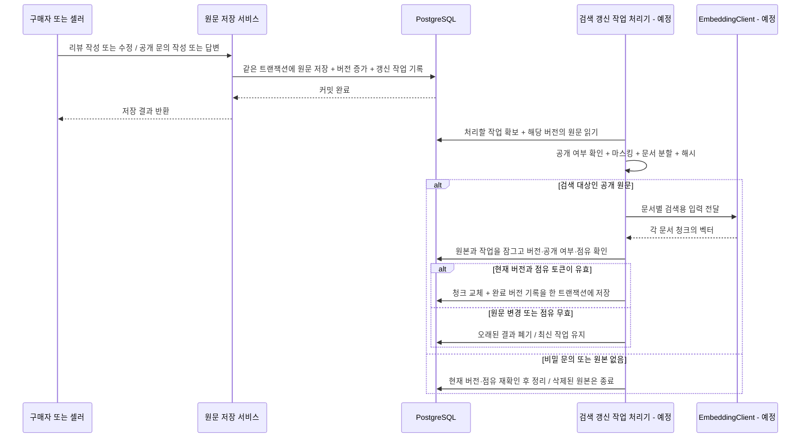
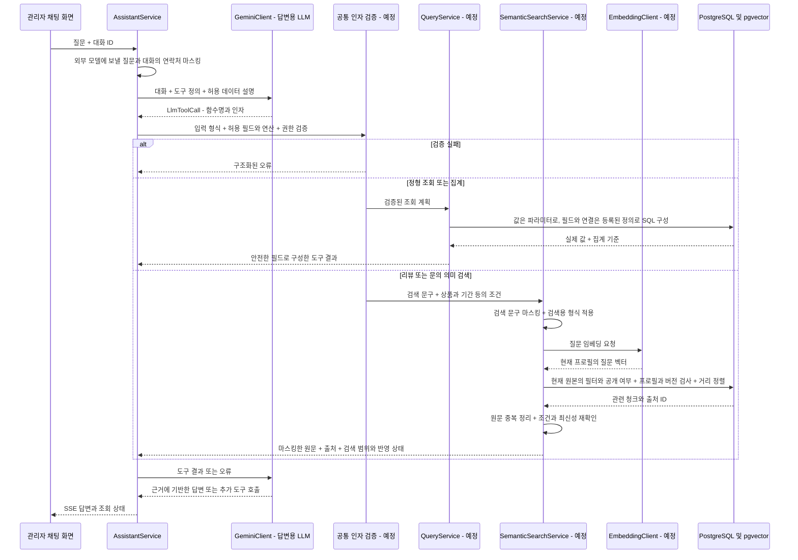

# 관리자 AI: pgvector·임베딩 도입과 범용 조회 설계

> 작성·구현 전 검토: 2026-10-13. 상태: **1단계 기반·2단계 리뷰 색인·3단계 리뷰 검색·4단계 공개 문의 검색과 채팅 연결 구현 — 검색 공개는 초기 색인·최종 사람 검토 후**. 구현 범위·실측·재현 명령은 [1단계 기록](./ex-ai-vector-search-phase1.md), [2단계 기록](./ex-ai-vector-search-phase2.md), [3단계 기록](./ex-ai-vector-search-phase3.md), [4단계 기록](./ex-ai-vector-search-phase4.md)에 보존한다.
> 이 문서는 대화에서 논의한 목표와 현재 소스 코드를 연결한다. 리뷰·공개 문의의 `EmbeddingClient`, `SemanticSearchService`, 검색 테이블·갱신 작업·`summarize_reviews(query)`·`summarize_inquiries(query)`를 구현했다. 범용 `QueryService`와 집계는 후속 설계다.
> 포트폴리오 측정 계획 추가: 2026-10-13. **10-1~10-6절**의 계산 예시는 실제 성과가 아니다. 리뷰 단계의 합성 자료 실측은 [3단계 결과](./ex-ai-vector-search-phase3.md)에 분리해 기록하며, 확정 답변 성공률은 최종 사람 검토 전까지 보고하지 않는다.

검토 결과 전체 방향은 현재 프로젝트에 적용할 수 있다. 구현 전 부족했던 프로필·저장 제약, 동시 갱신·재시도, 호출자 권한, 검색 결과 계약, 배송 조회 규격과 검증 기준을 아래에 확정했다. 첫 구현 단위는 **리뷰 의미 검색**이다. 문의와 배송 조회는 별도 단계로 이어지며, 집계·결합 분석의 지표 확정은 해당 단계의 착수 조건이다. 실제 임베딩 호출과 DB 환경 검증은 1단계에서 수행한다.

## 1. 도입 목표와 범위

현재 관리자 어시스턴트의 Function Calling·멀티턴·SSE·평가 흐름을 유지하면서, 필요한 정보를 가져오는 경로를 두 가지로 확장한다.

| 경로 | 담당하는 질문 | 처리 |
|---|---|---|
| 정형 조회 | 배송완료 시각, 주문 목록, 상품별 판매 수량, 기간별 매출 | 서버가 허용된 조회 계획을 검증하고 SQL로 실행 |
| 의미 검색 | 사이즈 불만, 배송 지연을 언급한 문의 등 표현이 다양한 텍스트 | 질문 임베딩과 저장된 문서 임베딩을 비교해 원문 검색 |
| 결합 분석 | 많이 팔린 상품에 어떤 사이즈 불만이 있는지 | 정형 조회에서 얻은 상품 ID로 의미 검색 범위를 좁히고 결과 결합 |

pgvector 도입과 범용 정형 조회는 별도 구현 과제다. 준비된 조회 도구가 없다고 벡터 검색으로 대체하지 않는다. 임베딩 모델은 답변 대신 벡터를 만들고, 답변용 LLM은 조회된 실제 값과 검색된 원문을 근거로 답한다.

첫 범위는 **관리자 읽기 전용**, 리뷰·공개 문의의 의미 검색과 배송 조회다. 이후 주문·상품 조회, 정의된 판매 지표 집계, 여러 도구를 연결하는 분석으로 확장한다. 임의 SQL 실행, 모든 사내 자료 자동 연결, 모델 학습은 별도 범위다.

## 2. 현재 구현에서 확인한 출발점

| 현재 구성 | 확인 내용 | 소스 |
|---|---|---|
| 도구 정의 | 매출, 주문 통계, 감사 로그, 상품, 리뷰, 문의의 6개 도구 | [assistant-tools.ts](../../backend/src/admin/assistant/assistant-tools.ts) |
| 도구 실행·대화 | `executeTool`, `streamChat`, `chatWithTrace`로 실행과 답변·호출 기록 연결 | [assistant.service.ts](../../backend/src/admin/assistant/assistant.service.ts) |
| 모델 경계 | `LlmToolDef`와 `LlmToolCall`로 도구 형식 추상화 | [llm-client.interface.ts](../../backend/src/intrastructure/ai/llm-client.interface.ts) |
| 리뷰 읽기 | `getReviewsForAssistant`에서 조건 조회·본문 마스킹 | [review.service.ts](../../backend/src/review/review.service.ts) |
| 문의 읽기 | `getInquiriesForAssistant`에서 본문 마스킹·비밀 문의 본문 제외 | [inquiry.service.ts](../../backend/src/inquiry/inquiry.service.ts) |
| 정형 조회 | 주문 통계는 상태별 건수만 반환. 주문 목록·상세는 백엔드에 있으나 AI 도구 연결과 완료 시각 조회 확장이 필요 | [dashboard.service.ts](../../backend/src/admin/dashboard/dashboard.service.ts), [order.service.ts](../../backend/src/order/order.service.ts) |
| 평가 | 골든셋 20문항, 규칙 평가, LLM-as-judge | [golden-set.json](../../backend/eval/golden-set.json), [run-eval.ts](../../backend/eval/run-eval.ts), [run-judge.ts](../../backend/eval/run-judge.ts) |
| 데이터 환경 | Docker 설정은 PostgreSQL 18, 스키마 변경은 마이그레이션 | [docker-compose.prod.yaml](../../docker-compose.prod.yaml), [migrations/index.ts](../../backend/src/database/migrations/index.ts) |

현재 설치된 `@google/genai` 2.8.0에는 `embedContent`와 출력 차원 옵션이 있고, TypeORM 0.3.28의 PostgreSQL 드라이버에는 `vector` 타입 지원이 있다. 임베딩·벡터 엔티티 도입을 위해 SDK·ORM을 먼저 교체해야 하는 상태는 아니다. 실제 확장 설치와 값 저장·조회는 1단계에서 확인한다.

갱신 연결에서 주의할 현재 코드도 있다. 리뷰 본문만 수정하면 기존 `review.created/deleted` 이벤트가 발생하지 않고, `ReviewDeletedEvent`에는 리뷰 ID가 없다. 체험 문의는 `DemoPolicyService.createDemoInquiry`라는 별도 저장 경로도 있다. 기존 평점 집계 이벤트만 구독해서는 검색 데이터의 변경을 빠짐없이 반영할 수 없다.

## 3. 추가할 구성

| 신규 구성 — 예정 | 역할 |
|---|---|
| `EmbeddingClient` / Gemini 구현체 | 질문·문서를 벡터로 변환. 답변용 `LlmClient`와 분리 |
| 검색 문서 작성 코드 | 공개 여부 확인, `scrubText`, 문서 분할, 본문 해시 생성 |
| `review_search_chunks`, `inquiry_search_chunks` | 마스킹한 문서 청크와 벡터·출처·버전 저장 |
| `search_embedding_profiles` | 모델·차원·전처리 규격과 색인할 원본 종류 등록 |
| `search_index_jobs`와 백그라운드 처리 | 변경 작업을 DB에 기록하고 생성·재시도·복구 수행 |
| `SemanticSearchService` | 조건 필터, 벡터 검색, 중복 원문 정리, 현재 원문 재확인 |
| 조회 대상 정의와 `QueryService` | 허용된 필드·관계·연산·지표를 정해 공통 SQL 실행 |
| 도구 인자 검증 | 객체 형식, 데이터별 허용 필드·연산, 호출자의 권한 검사 |

현재 `summarize_reviews`와 `summarize_inquiries`에는 선택 인자 `query`를 추가한다. 없으면 기존 조건 기반 읽기를 유지하고, 있으면 공통 의미 검색 서비스로 연결한다. 이것은 새로운 질문마다 도구를 추가하는 방식이 아니다.

정형 조회에는 `query_data`를 추가하고, 집계 확장 시 `aggregate_data`를 제공한다. 기존 6개 도구를 처음부터 전부 교체하지 않는다. 도구 설명은 기존 도구와 새 도구의 사용 범위를 구분하고, 기대 호출이 바뀌는 평가 문항은 변경 이유와 함께 갱신한다.

의존 방향은 원문 서비스 → 작업 기록 모듈, 어시스턴트 → 검색·조회 모듈로 둔다. 작업 기록 모듈은 `EntityManager`와 프로필 정의만 사용하며 관리자·리뷰·문의 서비스를 역으로 import하지 않는다. 임베딩 처리기와 검색기는 원본 엔티티를 읽는다. 일반 서비스와 체험·시드 코드가 같은 작업 기록 함수를 사용할 수 있게 하되, 시드 실행에 LLM 연결이 필요하지 않게 한다. 스케줄러는 이미 등록된 `ScheduleModule.forRoot()`를 활용한다.

## 4. 임베딩 모델과 저장 방식

첫 구현 후보는 현재 `@google/genai`를 활용할 수 있는 **`gemini-embedding-2`, 768차원**이다. 실제 한국어 검색 품질·지연·쿼터는 파일럿 평가 후 판단한다. 비용의 무료 구간은 계정·쿼터를 확인하고 사용한다. 외부 임베딩 API 대신 자체 실행이 필요하면 `multilingual-e5-small`을 별도 후보로 비교할 수 있지만, 실행 환경과 서버 자원 관리가 추가된다.

- 문서와 질문은 같은 모델·차원·검색용 입력 형식을 사용한다. 모델별 질문/문서 형식은 연결 코드에서 처리한다.
- 리뷰 본문, 공개 문의의 제목·본문·답변만 우선 벡터화한다. 상품명·카테고리·별점·문의 상태는 현재 원본 관계에서 조회해 필터와 결과 설명에 사용한다.
- 짧은 원문은 문서 하나로 처리하고, 긴 원문은 아래 전처리 규격으로 분할한다.
- 서로 독립적인 원문은 각각의 벡터를 얻도록 요청한다. 여러 입력을 하나의 `Content`로 묶어 하나의 집계 벡터로 만들지 않도록 응답 수와 차원을 확인한다.
- 전처리 버전은 마스킹·분할·검색용 형식의 변경을 식별한다. 다른 모델의 벡터는 차원이 같아도 섞어 비교하지 않는다.

검색 테이블은 원본 종류별로 분리해 외래 키로 연결한다. 다음은 공통 저장 항목이다.

| 항목 | 목적 |
|---|---|
| `review_id` 또는 `inquiry_id` | 원본 연결, 삭제 시 `ON DELETE CASCADE` |
| `chunk_index`, `text` | 문서 내 위치와 마스킹한 근거 원문 |
| `embedding vector(768)` | 초기 모델의 검색 벡터 |
| `profile_id` | 모델 ID·차원·전처리 규격을 묶은 검색 버전 |
| `content_hash` | 마스킹·전처리한 전체 문서 내용의 변경 확인 |
| `source_version` | 작업 대상 원본 버전과 결과의 최신성 확인 |

`source_version`은 원본의 검색용 버전을 단조 증가시키는 방식으로 구현한다. 갱신 작업과 완료된 색인은 이 버전을 함께 기록한다. 같은 내용을 다시 처리할 때 중복 청크가 쌓이지 않도록 원본 ID·프로필·청크 번호를 기준으로 저장한다.

초기에는 코사인 거리의 정확한 최근접 검색과 조건 컬럼의 일반 인덱스로 시작한다. 의미 검색 정확도와 DB 거리 계산의 정확도는 별개다. HNSW는 데이터 규모·검색 지연을 측정한 후 추가하며, 추가 시 조건 필터와 검색 누락을 재평가한다.

PostgreSQL 18을 유지하면서 pgvector 확장을 제공하는 컨테이너 구성으로 준비한다. 기존 데이터 디렉터리·볼륨·콜레이션 호환성을 확인한 뒤 배포하고, 확장·테이블은 마이그레이션으로 생성한다. 현재 마이그레이션 명시적 등록 배열에도 추가해야 한다.

### 4-1. 첫 임베딩 프로필과 전처리 규격

| 설정 | 초기 규격 |
|---|---|
| 프로필 ID 후보 | `gemini-embedding-2-768-review-inquiry-v1` |
| API 호출 | `models.embedContent`, `outputDimensionality: 768` |
| 질문 입력 | `task: search result \| query: {마스킹한 검색 문구}` |
| 문서 입력 | `title: {마스킹한 제목 또는 none} \| text: {마스킹한 청크}` |
| 리뷰 문서 | `comment`. 상품명·별점·작성자는 임베딩 본문에 붙이지 않음 |
| 문의 문서 | 제목은 title, 본문과 답변은 각각 구분 표지를 넣어 text로 연결. 비밀 문의 제외 |
| 정규화 | `scrubText` → 줄바꿈을 LF로 통일 → 앞뒤 공백 제거. 부정어·문장 부호 보존 |
| 분할 초깃값 | 최대 1,000 Unicode 코드 포인트, 겹침 100. 범위 안의 마지막 문단 경계를 우선하며 진행 위치가 반드시 증가하도록 처리 |
| 크기 제한 | 제목·검색용 접두사를 포함한 각 입력은 UTF-8 4,096바이트 이내. 초과하면 문자 경계에서 추가 분할. 원문당 최대 32청크, 초과는 `SOURCE_TOO_LARGE`로 기록 |
| 빈 검색 문서 | 제목·본문·답변이 모두 비면 벡터 없이 청크 0개로 완료. 내용을 임의 생성하지 않음 |
| 응답 검사 | 요청한 청크 수와 벡터 수 일치, 각 768개 유한 숫자, 0이 아닌 벡터 확인 |

위 크기 제한은 애플리케이션의 초기 제한이며 모델의 토큰 제한과 같은 단위가 아니다. 1단계 파일럿에서 한국어·이모지·긴 입력이 모델 한도 안에서 처리되는지 확인한다. 초과·절단이 발생하면 제한과 전처리 프로필을 수정하며, 자동 절단에 의존하지 않는다. 초기에는 **청크 하나당 요청 하나**로 대응 관계를 고정하고, 개별 `Content` 배치는 평가 후 최적화한다.

`gemini-embedding-2`에는 `taskType`을 보내지 않고 검색용 접두사를 사용한다. 768차원 자동 정규화 여부와 다중 입력의 집계 동작은 [공식 임베딩 규격](https://ai.google.dev/gemini-api/docs/embeddings?hl=en)을 기준으로 검증한다. `scrubText`는 이메일·전화번호 보호이며 이름·주소 등 모든 개인정보를 제거하는 기능은 아니다.

프로필에는 모델 ID, 차원, 전처리·마스킹·분할 버전과 입력 형식을 저장하고 변경하지 않는다. 색인 대상 종류와 작업 생성 활성 여부는 별도 운영 설정으로 둔다. 첫 단계에서는 리뷰만 활성화한다. 설정 `AI_SEARCH_PROFILE_ID`가 가리키는 프로필과 실제 클라이언트의 모델·차원이 다르면 의미 검색을 비활성화한다. 모든 인스턴스는 같은 활성 프로필을 사용한다.

모델·전처리 변경 시 새 프로필을 만들고 재색인 후 전환한다. 초기 테이블은 `vector(768)`이므로 차원을 바꾸려면 별도 스키마 변경도 필요하다. 프로필 ID만 바꾸면 다른 차원을 저장할 수 있는 구조가 아니다.

### 4-2. 스키마와 저장 제약

| 대상 | 필수 규격 |
|---|---|
| `reviews`, `inquiries` | 신규 `search_version bigint NOT NULL DEFAULT 1`, 양수 CHECK. API DTO에서 수정 불가 |
| `search_embedding_profiles` | 문자열 PK, 모델·차원·전처리 설정, 생성 시각. 초기 차원은 768 |
| 두 검색 청크 테이블 | 원본 FK·프로필 FK, `source_version`, `chunk_index >= 0`, 마스킹한 `text`, `content_hash`, `vector(768)` |
| 청크 유일성 | 각각 `UNIQUE(원본_id, profile_id, chunk_index)` |
| `search_index_jobs` 원본 연결 | `review_id` 또는 `inquiry_id` 중 정확히 하나만 존재하도록 CHECK. 두 FK 모두 삭제 연쇄 적용 |
| 작업 식별 | PK와 프로필 FK, 원본 버전. 리뷰/문의 각각 `UNIQUE(원본_id, source_version, profile_id)` |
| 작업 상태 | `pending`, `running`, `done`, `superseded`, `failed` |
| 작업 제어 | `attempts`, `next_run_at`, `lease_token`, `lease_expires_at`, 생성·완료 시각, 안전한 오류 코드 |
| 완료 결과 | 전처리 전체 문서의 SHA-256 `content_hash`, `chunk_count`. 0개 완료도 실패·미처리와 구별 |
| 작업 인덱스 | 대기 작업의 상태·다음 실행 시각, 실행 중 작업의 점유 만료 시각. 완료 상태 조회용 원본·프로필·버전 |

작업에는 원본 본문이나 개인정보를 복사하지 않는다. 해시는 제목·구분 표지·전체 마스킹 본문을 포함해 결정적으로 계산하고, 프로필과 함께 비교한다. `bigint` 버전은 TypeORM 경계에서 문자열 등 손실 없는 형식으로 다루며 JS `number`로 무조건 변환하지 않는다.

작업은 원본 버전별 기록으로 남긴다. 실행 중 작업을 최신 버전의 작업으로 덮어쓰지 않는다. 현재 원본 버전의 `done` 기록은 색인 준비 상태 확인에 쓰므로 정리 작업에서 보존한다. 이전 버전의 종료 작업은 기본 14일 후 정리할 수 있다.

### 4-3. DB 도입과 되돌리기 조건

현재 운영 Compose는 `/var/lib/postgresql`을 연결하지만 기본·개발 Compose는 `/var/lib/postgresql/data`를 연결한다. PostgreSQL 18 공식 이미지의 기본 `PGDATA`와 볼륨 위치는 [공식 이미지 설명](https://github.com/docker-library/docs/blob/master/postgres/README.md#pgdata)에서 확인한다. **실행 중 DB의 `SHOW data_directory`, 실제 마운트, PostgreSQL 버전을 먼저 확인**하고 기존 데이터가 보존되는 구성으로 정리한다. 설정 파일만 보고 현재 데이터 위치를 단정하지 않는다.

초기에는 현재 PostgreSQL 18 Alpine 기반에 호환되는 pgvector를 추가한 이미지를 우선 검증한다. PostgreSQL 바이너리와 확장의 빌드 대상 일치, `CREATE EXTENSION vector`, 실제 거리 쿼리를 확인하고 이미지·확장 버전을 고정한다. 기반 배포판을 변경해야 하면 기존 데이터·콜레이션의 호환성과 백업 복원을 검증한 뒤 별도 전환한다.

마이그레이션은 확장 → 프로필·원본 버전 → 작업·청크 테이블과 제약 순서로 작성하고 명시적 등록 배열에 추가한다. 기존 DB에도 적용되게 하며 초기화 SQL에만 넣지 않는다. 신규 기능을 끄는 것으로 우선 되돌릴 수 있게 하고, 새 원본 버전 컬럼과 파생 테이블은 기존 앱이 사용할 원본 값을 바꾸지 않도록 추가한다. 역마이그레이션은 신규 의존 객체를 제거하되 `DROP EXTENSION ... CASCADE`로 다른 기능의 확장 의존성을 삭제하지 않는다.

## 5. 원문 작성·수정 시 데이터 흐름



외부 임베딩 API를 기다리는 동안 원문 행의 DB 잠금을 유지하지 않는다. 결과 저장 단계에서만 다시 원문 버전을 확인한다. 작업은 DB에 남으므로 프로세스 재시작이나 API 실패 후에도 재시도할 수 있다. 처리 중단을 복구할 수 있는 작업 점유 만료와 재시도 횟수·다음 실행 시각을 둔다.

수정 직후에는 이전 버전의 청크가 검색에 사용되지 않게 한다. 삭제는 원본과 검색 청크의 외래 키 연쇄 삭제로 처리하고, 늦게 도착한 작업은 원본이 없음을 확인해 다시 생성하지 않는다. 본문 해시가 같고 프로필이 같으면 벡터를 재사용하고 완료 버전만 갱신할 수 있다.

일반 서비스, 체험 계정 저장, 시드·보정·가져오기처럼 원문을 변경하는 경로를 점검한다. 기존 데이터는 별도 일괄 색인 명령으로 준비하고, 주기적 대조로 누락·실패·버전 불일치를 찾아 같은 작업 기록 경로로 복구한다. 검색 색인은 원본으로부터 재생성할 수 있는 파생 데이터다.

### 5-1. 원본 변경의 트랜잭션 규칙

초기에는 **애플리케이션 트랜잭션과 공통 작업 기록 함수**를 사용한다. DB 트리거나 기존 평점 이벤트 구독에 작업 생성을 맡기지 않는다.

- 생성은 버전 1의 원본과 활성 색인 프로필별 작업을 같은 `EntityManager`로 저장한다.
- 수정은 원본 행을 잠그고 현재 권한·상태를 재검사한 뒤 DB에서 버전을 1 증가시키고 작업을 기록한다. 오래된 엔티티를 `save`하면서 버전까지 덮어쓰지 않는다.
- 비밀 문의는 외부 임베딩 요청을 만들지 않는다. 공개 → 비밀 전환 시 기존 청크도 원본 변경 트랜잭션에서 제거한다. 비밀 → 공개 전환 시 새 버전 작업을 생성한다.
- 삭제는 원본 FK의 연쇄 삭제로 청크와 작업을 제거한다. 삭제된 원문의 본문·벡터를 작업 보관용으로 남기지 않는다.
- 작업 기록이 실패하면 원본 변경도 롤백한다. 평점 집계·기존 리뷰 요약 갱신 이벤트는 커밋 이후 유지하며, 검색 처리 때문에 중복 발생시키지 않는다.

구현 시 확인할 쓰기 경로는 `ReviewService.create/update/delete`, `InquiryService.create/delete/answer`, `DemoPolicyService.createDemoInquiry`, 리뷰·문의 시드, `prepare-role-demo`, `repair-demo-data`, 대시보드 시드의 삭제다. 문의 본문·비밀 여부 수정 API는 현재 없으므로 비밀 전환은 변경 저장 함수와 통합 테스트로 검증하고, 실제 API가 추가되면 같은 규칙을 적용한다.

일괄 색인은 ID 커서로 원문을 나누어 읽고 현재 버전의 작업을 중복 없이 추가한다. 주기적 대조는 버전별 완료·대기·실패 상태를 비교한다. 관리 코드 밖의 직접 SQL 수정을 실시간으로 감지한다고 보장하지 않는다. 정기 해시 대조에서 버전이 같은데 내용이 다르면 원본을 다시 잠그고 버전 증가·작업 생성을 수행한다. 이미 같은 버전의 작업이 진행 중이면 중복 복구하지 않는다.

### 5-2. 작업 점유와 오래된 결과 차단

1. 짧은 트랜잭션에서 `FOR UPDATE SKIP LOCKED`로 실행 가능한 작업을 가져와 `running`과 새 점유 토큰·만료 시각을 기록한다. 원본 잠금 없이 즉시 커밋한다.
2. 현재 원본과 작업 버전이 다르면 `superseded`로 종료한다. 일치하면 마스킹·분할·해시를 계산하고 트랜잭션 밖에서 임베딩한다. 각 외부 요청 직전에도 원본 버전·공개 여부를 확인해 이미 바뀐 작업은 중단한다.
3. 결과 저장 트랜잭션에서는 **원본 → 작업** 순서로 잠근다. 원본 버전·공개 여부와 작업의 `running` 상태·점유 토큰·점유 만료를 모두 확인한다. 비밀 문의 청크 정리나 빈 문서 처리에도 같은 검사를 적용한다. 이미 삭제된 원본은 FK 정리 결과를 존중하고 다시 만들지 않는다.
4. 조건이 일치할 때만 해당 원본·프로필의 청크 전체 교체와 작업 `done` 기록을 함께 커밋한다. 빈 검색 문서는 기존 청크를 제거하고 `chunk_count: 0`으로 완료한다.
5. 점유를 잃은 작업은 청크와 작업 상태를 변경하지 않는다. 새 원본 버전이 생긴 경우 오래된 결과를 폐기하고 해당 작업만 종료한다.

초깃값은 처리기당 동시 작업 1개, 점유 120초·30초마다 갱신, 임베딩 요청 제한 시간 15초, 총 시도 최대 5회다. 시간 초과·429·5xx는 지수 지연과 jitter로 재시도하고 `Retry-After`가 있으면 존중한다. 잘못된 모델·권한·차원 설정은 반복 호출하지 않고 처리 중단 상태로 알린다. 원문 크기 초과 같은 재시도 불가능한 오류는 바로 `failed`로 기록한다. 만료 작업 재점유도 시도 횟수를 소모하며, 상한 이후는 `failed`로 남겨 명시적으로 재처리한다. 점유 갱신 실패 시 결과를 커밋하지 않는다.

현재 저장된 청크 집합에 대응하는 이전 완료 기록의 프로필·해시·청크 수가 현재 문서와 모두 같으면 벡터를 재사용할 수 있다. 과거 작업 중 해시가 같은 기록 하나를 찾았다는 이유만으로 다른 내용의 현재 청크를 재사용하지 않는다. 이때도 현재 버전과 점유 토큰을 검사하고 청크 버전·새 작업 완료 기록을 한 트랜잭션에 갱신한다. [PostgreSQL의 잠긴 행 건너뛰기](https://www.postgresql.org/docs/18/sql-select.html#SQL-FOR-UPDATE-SHARE)는 작업 큐 점유에만 사용하고 일반 데이터 조회에는 사용하지 않는다.

공개 여부와 최신성의 기준은 외부 전송 직전·결과 저장 시 DB에서 확인한 시점이다. 이미 공개 상태에서 외부로 전송한 요청은 이후 비밀 전환이나 삭제로 회수할 수 없다. 외부 API 대기 중 DB 잠금을 유지해 이 시간 구간을 막는 구조는 사용하지 않는다.

## 6. 관리자가 질문할 때 데이터 흐름



모델은 우리 코드를 직접 찾아 실행하지 않는다. 현재 `LlmToolDef` 방식으로 도구와 인자 규격을 제공하고, 서버가 공통 `LlmToolCall`을 실행한다. 데이터가 적을 때는 조회 대상 설명을 함께 제공하고, 커지면 `describe_dataset` 같은 설명 조회 도구를 추가할 수 있다.

검색 서비스의 1차 검증은 공개 여부·조건·원문 버전·문맥 길이 등 실행 규칙이다. 검색 결과는 의미적으로 올바른 답이라고 확정된 자료가 아니라 후보 원문이다. 답변용 LLM이 실제 질문과 후보 원문을 읽고 관련 근거를 선택하게 하고, 검색 평가에서 필요성이 확인되면 별도의 재순위화 단계를 추가한다. 관련성 임계값을 사용할 경우 골든셋과 별도 평가 데이터로 조정하며, 유사도 숫자를 정답 확률로 해석하지 않는다.

원문에 들어 있는 "규칙을 무시하라" 등의 지시도 인용 데이터로 취급한다. 모델이 추가 도구를 요청하더라도 동일한 서버 검증과 조회 권한을 거친다.

LLM에 전달할 JSON Schema와 서버에서 사용하는 검증 규칙은 같은 정의에서 관리한다. 모델이 만든 객체는 실행 시 다시 검사한다. 형식이 맞아도 질문에 잘못된 날짜 기준을 골랐을 수 있으므로, 질문과 조회 계획의 의미적 일치는 골든셋으로 별도 검증한다.

### 6-1. 권한과 도구 실행 경계

현재 HTTP 진입점은 관리자 가드로 보호되지만 `executeTool`은 호출자 정보를 받지 않는다. 확장 시 서버가 인증한 `ToolExecutionContext`에 관리자 ID·역할·요청 ID·중단 신호를 담아 디스패처와 검색·조회 서비스에 전달한다. 스트리밍과 비스트리밍 `chat` 모두 적용하고, 평가 러너도 명시적인 내부 평가 컨텍스트로 실행한다. 모델 인자로 `actorId`, 역할 또는 권한 범위를 받지 않는다.

JSON Schema와 런타임 검증은 현재 설치된 Zod 4의 동일 정의에서 생성한다. 알 수 없는 인자·필드·연산은 거절하고 날짜·정수·길이를 엄격히 검사한다. HTTP의 `ValidationPipe`만으로 모델 내부 도구 호출이 검증된다고 간주하지 않는다. 기존 도구도 인자를 직접 캐스팅하는 대신 검증하며 도구 결과에 안전한 필드만 명시적으로 구성한다. 이 경로에는 `ClassSerializerInterceptor`가 적용되지 않는다.

외부 LLM에는 마스킹한 질문·최근 대화·도구 결과를 보내고, 임베딩 API에는 마스킹한 문서와 검색 문구만 보낸다. 요청 인자·오류·평가 추적을 남길 때도 원문 연락처나 API 응답 본문을 그대로 기록하지 않는다. 검색 자료는 지시 권한이 없는 인용 데이터로 전달한다. 사용자 중단 신호는 질문 임베딩·DB 조회·다음 도구 호출에도 전파한다.

### 6-2. 의미 검색 규칙

- `query`가 없으면 기존 조회를 유지한다. 있으면 공백 제거 후 비어 있지 않은 최대 1,000자의 문구만 허용한다. 기존 상품·카테고리·별점·기간/상태 필터를 그대로 적용하고 적용된 조건을 결과에 기록한다.
- 현재 프로필, 원본 `search_version = 청크 source_version`, 해당 버전의 완료 작업, 공개 여부를 SQL에서 검사한다. 상품·카테고리·별점·문의 상태는 현재 원본을 기준으로 한다. 빈 상품 ID 범위는 빈 결과이며 전체 범위로 바꾸지 않는다.
- 초기 후보는 코사인 거리 `<=>` 오름차순 상위 **10청크**다. 동률은 원본 ID·청크 번호로 정렬한다. 원본 중복 제거 후 `take` 이내의 자료를 반환한다. 의미 검색 `take`는 기본 5·최대 10, 기존 조건 조회는 기본 30·최대 50을 유지한다.
- LLM에 전달할 근거는 전체 최대 12,000자, 원본별 최대 2청크로 제한한다. 생략한 원문 수·길이 제한 여부를 표시하며, 원문별 가장 가까운 거리로 순서를 정한다. 후보 수와 원본 수를 혼동하지 않는다.
- 반환 직전 원본을 다시 읽어 버전·조건·공개 여부를 확인하고 바뀐 후보는 제거한다. 보장하는 기준은 **마지막 DB 확인 시점**이다. 답변 생성 중 생기는 이후 변경까지 고정하는 장시간 잠금은 두지 않는다.
- 초기에는 고정 유사도 임계값과 재순위화 모델을 넣지 않는다. 가까운 후보를 찾았다는 것만으로 불만의 근거라고 확정하지 않는다. LLM은 실제 문구를 확인하고 관련 근거가 없으면 그렇게 설명한다.

## 7. 질문별 실행 예시

### 7-1. 가장 최근에 배송완료 처리된 상품 이름은?

다음은 **신규 `query_data`의 제안 규격**이다. 원본 DB의 실제 테이블명·컬럼을 모델이 임의로 지정하는 요청이 아니다.

```json
{
  "dataset": "deliveries",
  "fields": ["deliveredAt", "items.productName"],
  "filters": [{ "field": "deliveredAt", "operator": "isNotNull" }],
  "sortBy": "deliveredAt",
  "sortOrder": "DESC",
  "take": 1
}
```

`deliveries`는 셀러별 배송건을 기준으로 정의한다. 서버는 배송건을 먼저 완료 시각과 ID의 안정적인 순서로 1건 선택하고, 같은 주문 ID·셀러 ID의 주문상품들을 연결한다. `take: 1`은 상품 한 개가 아니라 배송건 한 건이다. 해당 배송건에 상품이 여러 개면 전부 반환한다. 이미 구매확정된 주문도 과거 배송완료 시각이 존재한다면 대상이 될 수 있다.

주문 전체가 모두 배송완료된 시점을 묻는 질문은 주문의 `deliveredAt`을 사용하도록 다른 조회 기준을 제공한다. 모호하면 답변에서 사용한 기준을 밝히거나 필요한 경우 확인한다. 이 경로에는 질문 임베딩이 필요 없다.

### 7-2. 의류에서 사이즈가 불편하다는 리뷰를 찾아줘

다음은 **기존 리뷰 도구에 추가할 인자 예시**다.

```json
{
  "query": "옷이 작거나 팔 부분이 좁아서 불편하다는 반응",
  "categoryName": "의류",
  "take": 10
}
```

카테고리는 기존 `resolveProductIds` 흐름으로 상품 ID 범위로 변환한다. `SemanticSearchService`는 질문 벡터를 생성하고, 그 상품들의 현재 리뷰에서 후보 원문을 검색한다. 서버는 조건 위반·오래된 버전·중복을 제외하고 출처 ID·인용문과 함께 전달한다. 질문에 실제로 관련 있는지는 답변용 LLM이 원문을 읽고 판단하며 별도 평가로 확인한다.

설명용 원문인 "팔 부분이 꽉 끼고 너무 작아요"는 후보가 될 수 있고, "작을까 걱정했는데 잘 맞아요"는 같은 주제라도 불만의 근거로 쓰면 안 된다. 유사도는 정답 확률이 아니다. 후보를 확보한 뒤 관련성을 확인하며, 필요한 경우 재순위화를 추가한다.

의미 검색 초깃값은 6-2절을 적용하고 평가로 조정한다. 상위 10청크를 가져와도 중복과 길이 제한 때문에 원문 10건이 반환된다고 보장하지 않는다. 결과의 출처 ID와 인용문은 함께 보존한다. UI에서 원문 링크를 제공하려면 실제 접근 가능한 경로와 권한을 확인해 연결한다.

별점 조건을 명시한 질문은 SQL 필터에 반영한다. "불편하다는 반응"을 무조건 2점 이하로 바꾸지는 않는다. 기존 골든셋의 저평점 기반 부정 리뷰 요약과 새 의미 기반 불만 검색은 평가에서 구분한다.

### 7-3. 지난주 많이 팔린 상품의 사이즈 불만을 정리해줘

먼저 `aggregate_data`가 정의된 판매 지표와 KST 기간 기준으로 상품별 순위를 반환한다. 다음 의미 검색은 그 상품 ID들로 범위를 한정한다. LLM은 실제 판매 수량과 검색된 리뷰의 내용을 결합한다.

이 예시는 6단계 대상이다. 해당 단계에서는 리뷰·문의 검색에 `productIds` 배열 필터도 추가하고 기존 단일 상품·카테고리 필터와의 충돌 규칙을 정한다. 현재 도구가 상품 ID 배열을 이미 받는 것으로 해석하지 않는다.

판매 지표는 주문 수·상품 수량·결제액을 구분하고, 결제일·환불 처리·조인 중복에 관한 기준을 등록한다. 벡터 상위 결과의 개수로 전체 불만 건수나 비율을 계산하지 않는다. 매출 감소의 이유처럼 인과관계가 필요한 질문은 조회된 사실과 가능한 해석을 구분한다.

## 8. 조회 가능한 데이터의 정의

각 컬럼에 함수를 하나씩 만드는 대신 데이터별 허용 정의와 공통 실행기를 제공한다.

| 정의 | 예 |
|---|---|
| 조회 대상과 한 건의 단위 | 배송건, 주문, 주문상품 |
| 필드와 의미 | 배송건 완료 시각, 주문 시점 상품명 |
| 연결 방법 | 배송건과 같은 주문·셀러의 주문상품 |
| 허용 연산 | 날짜 범위, 동일 값, NULL 여부, 정렬, 건수 제한 |
| 집계 지표 | 정의된 결제 합계, 상품 수량, 주문 건수 |
| 공개 범위 | 관리자 권한, 개인정보 제외, 안전한 결과 projection |

초기에는 등록된 정의의 SQL만 실행한다. 자유로운 Text-to-SQL은 나중에 별도의 검증·실행기로 확장할 수 있지만, 읽기 전용 권한·허용 데이터·시간 제한·질문 의미 검증이 추가로 필요하다. 모델 교체와 이 조회 정책은 분리한다.

### 8-1. 첫 `query_data` 계약

첫 등록 대상은 `deliveries` 하나다. 이후 동일 규격의 대상 정의를 추가한다.

| 항목 | 허용 규격 |
|---|---|
| 반환 필드 | `deliveredAt`, `shippedAt`, `status`, `items.productName`, `items.quantity` |
| 날짜 필터 | `deliveredAt`, `shippedAt`에 `gte`, `lt`, `isNotNull`. 값은 시간대가 포함된 ISO 시각 |
| 상태 필터 | `status`에 `eq`, 값은 `preparing`, `shipped`, `delivered` |
| 정렬 | `deliveredAt` 또는 `shippedAt`, `ASC`/`DESC`, NULL LAST와 배송 ID의 동률 정렬 |
| 건수 | 필수 정수 `take: 1..20`, 배송건 기준 |
| 표현 제약 | 필드는 1..5개, 필터는 최대 10개·AND만 지원. 임의 join, OR, SQL 표현식 없음 |

`dataset`, `fields`, `sortBy`, `sortOrder`, `take`는 필수이고 `filters` 생략 시 빈 배열로 처리한다. 같은 필드를 중복 요청하지 못하게 한다.

`isNotNull`은 value를 받지 않고 나머지 연산은 타입에 맞는 value가 필수다. 일 단위 기간은 모델 설명에 KST 시작 이상·다음날 시작 미만을 명시하고 서버에서 시각의 실재성과 범위 역전을 검사한다. SQL의 값은 파라미터로 바인딩하고 컬럼·정렬·관계는 서버 등록 정의에서만 가져온다.

7-1절 객체는 이 계약의 유효한 예다. 배송건 선별과 상품 연결은 한 SQL 문으로 실행하며, 선택된 배송건과 `order_id + seller_id`가 모두 일치하는 주문상품만 연결한다. 결과 `rows`에는 선택한 필드와 중첩 `items` 배열을 담고, 별도 출처 메타데이터에 배송 ID와 조회 단위를 기록한다. 상품명은 주문 당시 `order_items.product_name`을 사용한다.

응답 제한은 중첩 상품까지 최대 200개·전체 20,000자다. 초과하면 `RESULT_TOO_LARGE`로 조건 축소를 요청하며 일부 상품만 반환하면서 전체라고 설명하지 않는다. 조회 트랜잭션은 읽기 전용으로 실행하고 `statement_timeout` 초깃값 3초를 적용한다. 기존 도메인 서비스의 배송·주문 갱신은 이 도구에서 호출하지 않는다.

주문 전체 완료 시점의 `orders` 대상은 후속 정의가 등록된 뒤 제공한다. 아직 지원하지 않는 기준은 지원 범위를 알리며, 배송건 완료를 주문 전체 완료로 바꾸어 답하지 않는다. 판매 지표의 결제·환불·취소 기준은 6단계에서 별도 확정하고 집계 도구를 등록한다.

## 9. 검색 실패와 오류 처리

- 조건에 맞는 원본 없음, 아직 색인 반영 중, 임베딩 API 실패는 서로 다른 도구 상태로 반환한다. 후보에서 관련 근거를 못 찾은 경우는 답변에 별도로 명시한다. API 실패나 반영 지연을 "원본 데이터 없음"으로 설명하지 않는다.
- 인자가 잘못되면 오류와 허용 범위를 도구 결과로 전달한다. 모델은 기존 라운드 상한 안에서 수정 요청하거나 사용자에게 한계를 설명한다.
- 검색 결과가 적더라도 다른 상품·기간의 자료로 조건을 몰래 넓히지 않는다. 명시적으로 선택한 대체 경로는 사용한 범위를 밝힌다.
- 기존 조건 조회를 대체 경로로 사용할 경우 "의미 검색 결과"와 구분한다. 연락처·비밀 문의 보호는 대체 경로에도 적용한다.
- 벡터, 임베딩 API의 내부 응답, 개인정보가 포함된 원본을 답변 근거로 그대로 전달하지 않는다. 마스킹한 원문과 필요한 메타데이터만 전달한다.

### 9-1. 도구 결과 계약과 화면 연결

신규 경로는 `status`, `mode`, `scope`, `data`, `coverage`, `error`를 가진 결과 객체를 사용한다. `mode`는 `structured` 또는 `semantic`이며, `scope`에는 적용한 조건·시간대·조회 단위·프로필을 넣는다. 오류가 있을 때 원본 데이터나 내부 SQL은 포함하지 않는다. 기존 조건 조회 결과 형식은 회귀 검증 후 필요한 필드만 추가한다.

| 상태 | 의미 |
|---|---|
| `ok` | 검증된 실제 값 또는 검색 후보를 확보. 의미 관련성의 확정은 아님 |
| `no_data` | 지정 조건에 해당하는 조회 가능한 원본이 없음 |
| `no_candidates` | 원본은 있지만 빈 본문 등으로 검색 청크가 없음. 전체에 관련 자료가 없다는 뜻은 아님 |
| `indexing` | 검색할 원본의 색인이 아직 반영 중이며 현재 반환할 후보가 없음 |
| `unavailable` | 임베딩·DB 장애, 설정 불일치, 처리 실패 등으로 정상 검색 불가 |
| `invalid_arguments` | 객체·조건·필드가 허용 규격에 맞지 않음 |
| `forbidden` | 서버의 호출자 컨텍스트가 조회 권한을 충족하지 못함. 데이터 반환·권한 재시도 없이 종료 |
| `unsupported` | 등록하지 않은 조회 기준 또는 비활성 기능 |

검색 후보가 일부 있으면 `ok`와 함께 `coverage`에 준비·대기·실패 원본 수와 `partial` 여부를 기록한다. 작업 누락도 미반영으로 계산한다. 후보가 없고 실패 작업이 있으면 `unavailable`, 대기·실행 중·누락 작업만 있으면 `indexing`, 모두 정상 반영됐지만 청크가 없으면 `no_candidates`로 구분한다. 원본·색인 상태는 같은 읽기 스냅샷에서 계산하며 큰 범위의 집계 시간도 검색 지연에 포함해 측정한다. 인덱싱 중인 내용을 포함한 전체 분석이라고 표현하지 않는다.

의미 검색 `data.sources`는 원본 종류·ID, 상품 ID, 생성 시각, 리뷰 별점/문의 상태, 마스킹한 인용 청크로 구성한다. 거리와 벡터는 내부 검색·평가에만 보존한다. 최종 답변에는 사용한 원본 ID와 인용을 명시하고 후보가 무관하면 **“가져온 자료에서는 관련 근거를 찾지 못했다”**고 답한다. 서버가 임계값 없이 `no_relevant_evidence`를 판정한다고 구현하지 않는다.

초기 화면은 기존 SSE 이벤트를 유지한다. 도구의 실패와 반영 지연은 최종 답변으로 안내하고, 새 정형 도구의 진행 문구는 프론트의 `toolLabel`에 추가한다. 기존 ‘조회 완료’ 표시는 도구 실행 종료이며 결과 성공을 보장하는 표시가 아니다. 출처 링크·별도 출처 이벤트·실패 배지는 추가 UI 과제로 분리하며 완료된 기능으로 표시하지 않는다.

## 10. 평가와 관측

| 평가 층 | 방법 |
|---|---|
| 도구와 조회 계획 | 기존 20문항 회귀 + 필드·기간 기준·정렬·집계·조합 문항 추가 |
| 의미 검색 | 별도 질문과 정답 원문 ID를 지정해 Recall@5와 Precision@5 측정 |
| 답변 | LLM-as-judge로 원문 충실성과 함정 질문 평가, 일부 사람 대조 |
| 최신성과 보호 | 본문만 수정, 삭제, 비밀 문의 전환, 체험 문의, 늦게 완료된 작업의 재현 검증 |
| 운영 비용과 지연 | 임베딩 호출·토큰, 검색 지연, 대기·실패 작업, 원본 대비 색인 반영 상태 기록 |

Recall@5는 지정한 관련 원문 중 상위 5개에서 찾은 비율이다. Precision@5는 관련 원문 수를 5로 나누며 5개 미만 반환 시 남은 자리는 비관련으로 계산한다. 반환한 자료 중 관련 비율은 별도로 기록한다. 청크가 아니라 중복 제거한 원문 ID 기준으로 채점하고, 정답 자료가 없는 문항은 Recall 계산에서 제외해 근거 없음 응답을 별도로 평가한다.

동일한 질문·원본 데이터로 기존 조건 조회와 새 의미 검색을 비교한다. 개선에 쓴 문항 외에도 별도 평가 문항을 둔다. 기존 17/17은 도구 선택 평가 결과이며 새 검색 정확도로 표시하지 않는다.

평가 DB는 고정한 리뷰·문의·배송 fixture를 사용하고 기준 날짜도 고정한다. 질문마다 정답 원문 ID와 관련·비관련 판정 이유를 사람이 지정한다. 사이즈 단어 없는 불만, 걱정했지만 잘 맞았다는 긍정문, 높은 별점의 불만, 다른 상품·기간, 관련 원문 없는 질문을 포함한다. 표현 변경 질문을 만들어도 같은 원문과 유사 질문이 개선용·최종 평가에 함께 섞이지 않도록 분리한다.

비교는 각 문구가 반환한 자료의 원문 기준 지표, 최종 답변의 잘못된 긍정·부정 해석, 지연·호출 수를 함께 기록한다. 구 조건 조회가 의미 필터를 지원하는 것으로 채점하지 않고 동일 범위의 최근순 결과를 기준선으로 삼는다. 결과 파일에는 모델·프로필·후보 수·문맥 제한·평가 자료 버전·코드 버전을 남긴다.

### 10-1. 포트폴리오에서 우선 보여줄 수치

첫 결과 보고서는 **관련 원문을 찾는 능력, 근거를 사용해 질문에 맞게 답하는 능력, 변경된 데이터를 올바르게 반영하는 능력**을 중심으로 작성한다. 지연·호출량은 이 품질을 얻는 데 든 자원으로 함께 보고한다. 결과를 하나의 ‘AI 정확도’로 합치지 않는다.

| 우선순위 | 지표 | 쉬운 설명 | 기록 형태 |
|---|---|---|---|
| 핵심 | **Hit@5**, 보조로 Recall@5·Precision@5 | 상위 5개 원문 안에서 답에 필요한 자료를 하나라도 찾았는가? 얼마나 빠짐없이, 적절하게 찾았는가? | 기준선 → 도입 후 비율, 평가 질문 수, 차이 `%p` |
| 핵심 | **질문 단위 답변 성공률** | 자료를 찾는 데 그치지 않고 질문의 조건과 필수 내용을 충족해 답했는가? | 성공 질문 수 / 전체 질문 수. 근거 있음·없음 분리 |
| 핵심 | **변경·보호 검증 통과 건수** | 수정·삭제·비밀 전환·오래된 작업·연락처 처리 규칙을 지켰는가? | 시나리오별 통과 / 실행 수, 잘못 노출된 결과 건수 |
| 보조 | **저장 요청 → 검색 가능 지연** | 리뷰를 바꾼 뒤 새 내용이 검색될 때까지 얼마나 걸렸는가? | 변경 유형별 P50·P95·관측 수·시간 초과 수 |
| 보조 | **검색 및 전체 응답 시간** | 자료를 찾는 시간과 답변까지 받는 시간이 각각 얼마인가? | P50·P95, 성공/실패 요청 수, DB·서버·자료 규모 |
| 보조 | **임베딩·LLM 호출량과 사용량** | 질문 하나와 초기 색인에 외부 호출이 얼마나 필요한가? | 요청당 호출 수, 토큰/문자 수, 실제 또는 추정 비용 |
| 후속 | **정형 조회 성공률** | 배송 질문에 실제 완료 시각·상품명을 정확히 답했는가? | 조회 계획 일치와 실제 결과 일치를 각각 성공 / 전체로 기록 |

Hit@5가 높아도 부정·긍정을 잘못 해석해 답변에 실패할 수 있다. 답변이 가져온 자료에 충실해도 질문과 무관한 자료였다면 실패다. 검색 품질과 답변 품질을 분리하는 근거는 [RAG 평가 문서](https://docs.langchain.com/langsmith/evaluate-rag-tutorial)를 참고하되, 평가 서비스나 별도 프레임워크 도입은 필수가 아니다. 현재 평가 러너를 확장해 측정한다.

### 10-2. 검색·답변 지표의 계산과 판정

질문별 정답 원문 ID 집합을 `G`, 서버의 조건 검사·원문 중복 제거·문맥 제한 후 LLM에 전달되는 상위 5개 원문 ID를 `S5`로 둔다. 모델이 최종 답변에서 골라 인용한 ID만으로 검색 점수를 계산하지 않는다.

| 지표 | 질문 하나의 계산 | 전체 결과 |
|---|---|---|
| Hit@5 | `G`와 `S5`가 하나라도 겹치면 1, 아니면 0 | 근거가 있는 질문들의 평균 × 100 |
| Recall@5 | `정답과 겹치는 원문 수 / G의 원문 수` | 근거가 있는 질문들의 평균 × 100 |
| Precision@5 | `정답과 겹치는 원문 수 / 5` | 근거가 있는 질문들의 평균 × 100. 5개 미만이면 나머지는 0 |
| 근거 없음 응답 성공률 | 정답 원문이 없는 질문에서 자료 범위 안에 근거가 없음을 정확히 설명하면 1 | 근거 없는 질문의 성공 수 / 해당 질문 수 |

예를 들어 **계산 설명용 가상 자료**에서 정답이 `{11, 12, 13}`, 반환 원문이 `[11, 90, 12, 91, 92]`라면 Hit@5=1, Recall@5=2/3=66.7%, Precision@5=2/5=40%다. 같은 원문의 청크가 두 번 검색돼도 원문 하나로 센다. 관련 원문이 하나뿐인 질문은 Hit@5=100%여도 Precision@5의 최대값이 20%이므로 지표의 목적과 라벨 수를 함께 해석한다. [검색 평가의 정밀도·재현율 정의](https://nlp.stanford.edu/IR-book/html/htmledition/evaluation-of-unranked-retrieval-sets-1.html), [상위 k개 평가](https://nlp.stanford.edu/IR-book/html/htmledition/evaluation-of-ranked-retrieval-results-1.html)를 기준으로 계산한다.

Recall을 계산하려면 해당 조건 범위의 관련 원문을 모두 판정한다. 일부 예시 원문만 정답으로 지정했다면 ‘라벨을 부여한 원문 집합 대비 Recall’이라고 한계를 명시한다. 라벨이 없는 후보는 최종 평가 전에 사람이 판정한다. 정답이 5개보다 많으면 Recall@5로 모두 찾을 수 없으므로 정답 집합 크기도 기록한다.

**답변 성공률**은 문장 표현이 정답 예시와 동일한지를 채점하지 않는다. 질문별로 다음 체크리스트를 모두 만족하면 성공으로 판정한다.

1. 요청한 상품·카테고리·기간·배송 단위 등의 조건을 지켰다.
2. 질문별 필수 사실이나 인용 근거를 제공했다. 관련 원문 ID를 가져왔어도 인용 청크에 필요한 내용이 없으면 실패다.
3. 수치·상품명·긍정/부정 해석이 원문 및 정답 기준과 일치한다.
4. 자료에 없는 사실, 표본으로 계산한 전체 불만 비율, 근거 없는 인과관계를 추가하지 않았다.
5. 근거 없음·반영 중·장애는 실제 상태에 맞게 설명했다.

근거 없는 질문에 일괄적으로 ‘모른다’고 답하는 시스템이 높은 점수를 얻지 않게 근거 있는 질문의 성공률도 별도로 표시한다. LLM-as-judge는 판정 보조로 사용하고, 초기 최종 평가 30문항은 개발자가 전체를 대조한다. judge 판정과 사람 판정이 다르면 이유를 기록한다. judge 모델·프롬프트·반복 횟수와 사람 검토 범위를 보고서에 남긴다.

오류는 숨기지 않는다. 질의가 유효한데 검색 API가 실패하면 그 질문의 Hit·Recall·Precision은 0, 답변은 실패로 계산하고 API 오류 건수를 별도 표시한다. 근거 없는 질문의 API 실패도 올바른 ‘근거 없음’ 응답으로 채점하지 않는다. 판정 실패·건너뛴 질문·중단된 실행을 빼서 높은 비율을 만들지 않고 계획·실행·미실행·판정 불가 건수를 함께 기록한다. 일부만 실행한 보고서는 부분 결과로 표시한다.

### 10-3. 평가 자료와 비교 실험

다음은 **이 프로젝트의 초기 측정 계획**이다. 업계 공통 최소 표본 수나 이미 보유한 자료 수를 뜻하지 않는다.

| 자료 | 초기 계획 | 용도 |
|---|---|---|
| 기존 골든셋 | 현재 20문항 유지 | 기존 도구·개인정보·미지원 안내 회귀 확인 |
| 검색 개선용 질문 | 별도 20문항 | 모델·입력 형식·청크·후보 수·답변 규칙 조정 |
| 검색 최종 평가 | 별도 30문항: 근거 있음 20 + 근거 없음 10 | 포트폴리오에 보고할 고정 평가. 개선용과 분리 |
| 원문 fixture | 리뷰 100건을 초기 구성 목표로 설정 | 관련 원문과 같은 주제의 긍정문·다른 상품·다른 기간·무관한 원문 포함 |
| 동기화·보호 시나리오 | 리뷰 단계에서 최소 10종 정의 | 변경 반영과 재시도·삭제·연락처 처리 검증. 문의 단계에서 추가 |
| 배송 평가 | 배송 단계에서 별도 20문항 구성 | 셀러별 배송·복수 상품·동률·NULL·구매확정 기준 검증 |

현재 데모·시드 원문을 확인한 뒤 평가용 자료를 고정한다. 부족하면 합성 원문을 추가하되 기존 원문과 합성 원문 수를 각각 표시한다. 테스트 자료로 만든 결과를 실제 고객 이용 성과로 표현하지 않는다. 문의는 별도 자료 버전을 추가하고 리뷰 단계의 결과를 보존한다. 반복 실행을 해도 ‘서로 다른 질문 30개’가 ‘질문 90개’로 늘어나는 것은 아니다.

각 질문은 `caseId`, 질문, 고정 검색 문구, 적용 조건, 정답 원문 ID, 관련/비관련 판정 이유, 답변 필수 사실, 근거 없음 여부를 가진다. 평가 전 원본·색인이 준비됐음을 확인한다. 개선용 자료에서 합격 기준과 설정을 결정한 뒤 최종 자료를 잠근다. 최종 결과를 보고 모델·설정을 다시 고른다면 그 자료는 개선용으로 바뀐 것이므로 새 최종 평가 버전이 필요하다.

| 비교 대상 | 비교 방식 | 해석 |
|---|---|---|
| A. 기존 조건 조회 | 같은 상품·기간·평점/상태에서 최근순 원문 5건 | 현재 기능의 기준선. 의미 조건을 지원하는 것으로 가정하지 않음 |
| B. 첫 벡터 검색 | 동일한 원문·필터에서 초기 프로필, 10청크 후보 → 원문 최대 5건 | pgvector·임베딩 도입 효과 |
| C. 개선한 벡터 검색 | 개선용 질문에서 관찰한 실패 원인을 수정한 버전 | 입력 형식·분할·후보 수 등의 변경 효과. 실제 개선을 수행한 경우만 추가 |

검색만 비교할 때는 LLM이 도구와 검색 문구를 선택하게 하지 않고 같은 고정 검색 문구·필터를 검색 서비스에 직접 전달한다. 이후 전체 어시스턴트 평가에서 자연어 질문 → 도구·인자 선택 → 검색 → 최종 답변을 따로 측정한다. 원문과 조건이 다른 결과를 검색 방식의 개선으로 비교하지 않는다. 검색에 사용하는 원문 수·청크 수와 실제 반환 원문 수도 함께 기록한다.

최종 답변 비교에서는 답변 모델·날짜·대화 초기 상태·입력 및 문맥 제한을 같게 유지한다. 변경한 설정은 보고서에 명시한다. 가능하면 각 질문을 3회 실행해 반복별 결과와 전체 평균을 함께 남기고, 한 번만 실행했다면 1회 측정으로 표시한다. API 호출 순서는 A/B를 교대로 배치하고 같은 요청 동시성·캐시 설정을 사용한다. 실행 사이의 쿼터 대기 시간은 응답 시간에서 제외하되 요청 내부 재시도 대기는 포함한다.

50문항 전체를 한 번에 완성할 필요는 없다. 개선용 질문과 작은 원문 fixture로 첫 구현을 확인하고, 공개 전에 최종 평가 자료를 확정한다. 수치가 올라가지 않았다면 그 결과와 실패 원인을 남긴다. 배송 조회의 지원 범위 확대는 SQL 조회 결과로 보고하며 벡터 검색의 개선 수치에 합치지 않는다.

### 10-4. 지연·동기화·사용량을 측정할 위치

| 측정 | 시작 → 종료 | 보고할 조건 |
|---|---|---|
| DB 벡터 검색 시간 | 거리 검색·필터 SQL 실행 직전 → 결과 수신 | SQL 한 번의 시간. 질문 임베딩·LLM 시간 제외 |
| 검색 도구 전체 시간 | 인자 검증 통과 → 후보·출처·coverage 결과 준비 | 질문 임베딩·DB 검색·원문 재확인·coverage 계산 포함 |
| 첫 답변 텍스트 시간 | 채팅 요청 시작 → 첫 `text` 이벤트 | `meta`·`tool` 이벤트는 답변 텍스트로 세지 않음 |
| 전체 답변 시간 | 채팅 요청 시작 → 정상 `done` | 도구 선택·임베딩·검색·답변 생성·재시도 포함 |
| 새 원문 검색 가능 시간 | 저장 API 호출 시작 → 해당 버전의 색인 완료와 검색 노출 최초 확인 | 같은 테스트 실행기의 단조 시계 사용. 저장 처리·대기·임베딩과 관측 간격 포함 |
| 수정·삭제 후 잘못된 노출 | 저장/삭제 성공 응답 이후의 검색 결과 검사 | 예전 내용·삭제 원문·비밀 문의의 잘못된 노출 건수 / 검사 수 |

검색 가능 시간은 ‘순수 임베딩 시간’ 또는 ‘정확한 DB 커밋 후 시간’으로 바꾸어 표현하지 않는다. 반복 확인 간격은 초깃값 200ms로 기록하고, 제한 시간 내 준비되지 않은 건수도 포함한다. 확인 루프는 DB의 버전·완료 상태와 사전에 준비한 질문 벡터의 실제 검색 결과를 사용해 매번 외부 임베딩·LLM 호출이 발생하지 않게 한다. 새 근거를 검색할 수 있는 생성·수정만 이 시간 측정에 포함하고, 빈 문서·삭제·비밀 전환은 제외 상태가 맞는지 별도 검증한다. 수정은 이전 버전 배제와 새 버전 준비를 따로 검증한다.

P50은 시간을 짧은 순서로 정렬했을 때 가운데 수준, P95는 95%가 그 시간 안에 끝나는 수준이다. 계산은 각 분포의 `ceil(0.50 × n)`·`ceil(0.95 × n)`번째 값으로 고정한다. 성공 요청의 P50·P95와 전체 오류·시간 초과 수를 함께 보고하고 실패 소요 시간도 따로 저장한다. 반복 수·원본 수·청크 수·동시 요청 수·CPU/메모리·DB 위치·캐시·관측 구간을 기록한다. 30건의 P95는 작은 표본의 관측값이며 운영 SLA나 대규모 처리량 검증으로 표현하지 않는다. 부하 성능을 주장하려면 별도의 동시 요청 실험이 필요하다.

사용량은 **초기 일괄 색인**, **수정 재색인**, **관리자 질문**, **평가 judge 호출**을 분리한다. 질문 비용에는 질문 임베딩과 모든 답변용 LLM 라운드·재시도를 포함한다. 실제 외부 호출 수는 클라이언트의 요청 경계에서 계측하고 도구 호출 수와 구분한다. 현재 `run-eval.ts`의 `toolCalls.length + 1`은 API 왕복 추정치이며 실패 요청의 usage도 총계에 포함되지 않을 수 있으므로 새 측정에서 보완한다.

API가 토큰 사용량을 주지 않으면 null과 ‘미제공’으로 기록하고 입력 문자/바이트·요청 수를 별도 보존한다. 실제 청구액, 측정일 단가로 계산한 추정 비용, 무료 구간 사용을 구분한다. 무료 사용에 대해 유료 비용 절감액을 성과로 작성하지 않는다. 토큰·호출이 늘더라도 검색 품질이 개선됐으면 그 교환 관계를 설명한다.

변경·보호 검증은 전체 통과율만 적지 않고 리뷰 본문 수정·메타데이터 변경·삭제·빈 문서·같은 작업 재등록·늦은 이전 결과·점유 만료·저장 롤백·질문/원문/대화 연락처·재시도 실패를 각각 기록한다. 문의 단계에는 공개/비밀 전환·답변 변경·체험 경로를 추가한다. 보고 문구는 ‘실행한 시나리오 N건에서 잘못된 노출 0건’이며, 모든 개인정보나 동시성 문제가 해결됐다는 보장은 아니다.

### 10-5. 결과 파일과 포트폴리오 표

다음 경로는 **구현할 산출물 계획**이며 지금 결과 파일이 존재한다는 뜻은 아니다.

- `backend/eval/search/`: fixture, 개선용·최종 질문, 정답·판정 기준과 버전.
- `backend/eval/results/search-<runId>.json`: 실행 메타데이터, 질문별 원문 순위·도구 계획·마스킹한 근거·답변·판정·시간·사용량·오류.
- `backend/eval/results/search-<runId>.csv`: 질문별 A/B/C 점수와 단계별 시간. ID로 JSON 근거 연결.
- `docs/portfolio/ex-ai-vector-search-results.md`: 환경, 자료 구성, 아래 결과표, 실패 사례와 변경 이유, 재현 명령, 한계.

기존에 저장된 측정 결과와 새로 측정할 결과를 구분한다. [2026-07-25 도구 평가 기록](../../backend/eval/results/2026-07-25T20-43-47.json)은 전체 20문항 중 도구 평가 대상 **17/17**, 오류 0건이다. [같은 실행의 judge 기록](../../backend/eval/results/judge-2026-07-25T20-43-47.json)은 도구 결과 충실성 **15/15**, 거절·안내 태도 **5/5**다. 평가 대상이 겹치므로 분모를 더하지 않는다. 이 기록에는 벡터 검색 정확도나 실제 주문·리뷰 내용에 대한 새 정답 일치율이 없다.

| 보고 항목 | A. 기존 조회 | B. 벡터 도입 | C. 개선 후 | 근거 |
|---|---|---|---|---|
| 원문·청크 수, 질문 자료 버전, 모델·프로필 | 미측정 | 미측정 | 미측정 | 실행 메타데이터 |
| Hit@5 — 근거 있음 질문 N개 | 미측정 | 미측정 | 미측정 | 질문별 성공 수/N, A→B·B→C 차이 |
| 평균 Recall@5·Precision@5 | 미측정 | 미측정 | 미측정 | 질문별 점수와 평균 |
| 답변 성공 — 전체/근거 있음/근거 없음 | 미측정 | 미측정 | 미측정 | 각 성공 수/대상 수 |
| 기존 골든셋 회귀 — 평가 영역별 | 새 기준선 미측정 | 미측정 | 미측정 | 과거 기록과 별도로 현재 코드 실행 |
| 수정·삭제·오래된 작업·연락처 검증 | 해당 없음 또는 미측정 | 미측정 | 미측정 | 시나리오별 실행·통과·위반 건수 |
| 저장 요청→검색 가능 P50/P95·시간 초과 | 해당 없음 | 미측정 | 미측정 | 관측 수·시간 간격·변경 유형 |
| DB 검색/검색 도구/전체 답변 P50·P95 | 미측정 | 미측정 | 미측정 | 성공 수·전체 오류 수·환경 |
| 초기 색인/질문당 호출·usage·비용 | 미측정 | 미측정 | 미측정 | 실측·추정·미제공 구분 |

‘미측정’을 0으로 입력하지 않는다. 미실시 개선 버전 C는 열을 제거하고, 해당 없는 영역은 이유를 표시한다. 단일 실행의 점수와 반복 실행 평균을 섞지 않는다. 비율 차이는 `B − A`를 **퍼센트포인트(%p)**로 표시한다. 예를 들어 60%→80%는 +20%p이며 **계산 예시**일 뿐 프로젝트 결과가 아니다.

### 10-6. 수치를 성과 문구로 바꾸는 방법

포트폴리오에는 모든 지표를 나열하기보다 **문제 → 구현 → 동일 조건 비교 → 실패 사례와 한계**를 연결한다. 다음은 실제 측정 후 빈칸을 채울 양식이다.

> 최근순 리뷰 조회에서 표현이 다른 불만 근거를 놓치는 문제를 개선하기 위해 pgvector·임베딩 검색을 기존 도구 호출에 연결했다. 고정 원문 `{원문 수}`건과 개선에 사용하지 않은 평가 질문 `{질문 수}`개에서 Hit@5를 `{A 성공 수}/{N} ({A%})`에서 `{B 성공 수}/{N} ({B%})`로 개선했다(`{차이}%p`). 최종 답변 성공률은 `{성공}/{전체}`였으며, `{구체적 오검색 사례}`를 확인해 `{실제 변경}`을 적용했다.

> 원본 버전과 작업 점유 검증을 적용해 수정·삭제·늦은 작업 완료 등 `{시나리오 수}`종, `{실행 수}`회 검증에서 잘못된 결과 노출 `{건수}`건을 기록했다. 저장 요청부터 새 원문 검색 가능까지 P95는 `{시간}`이었다(`{관측 수}`회, 확인 간격 `{간격}`, 시간 초과 `{건수}`건).

> 배송건을 기준으로 한 공통 조회 계획 검증·실행기를 추가해 최근 배송완료·다중 셀러·복수 상품 등 고정 질문 `{N}`개에서 실제 DB 정답 일치 `{성공}/{N}`을 확인했다. 이 결과는 의미 검색과 별도로 평가했다.

수치가 개선됐을 때만 ‘개선했다’고 작성한다. 아직 평가 전이면 구현 내용과 평가 계획만 작성하고, 결과가 같거나 낮으면 실제 값과 원인을 적는다. 실패 사례에는 질문·정답 원문·잘못 반환한 원문·원인 가설·수정 내용·전후 결과를 보존한다. 답변 규칙 수정으로 해석만 나아졌다면 검색 Recall이 개선됐다고 표현하지 않는다.

높은 비율 하나보다 **평가 대상과 분모를 설명하고 원본 결과로 재현할 수 있는 수치**를 우선한다. 작은 데모 자료의 100%는 그 자료에서의 결과다. 측정일·모델·자료 규모·합성 자료 포함 여부·반복 수·판정 방식을 포트폴리오에 함께 적는다.

## 11. 구현 순서와 완료 조건

1. **환경과 규격**: PostgreSQL 18의 pgvector 환경 확인, 모델 파일럿·프로필 확정, 신규 테이블 마이그레이션.
2. **리뷰 색인**: 임베딩 클라이언트, 마스킹·분할, 기존 데이터 일괄 색인, 변경 작업의 트랜잭션 기록과 재시도.
3. **리뷰 검색과 연결**: 현재 원본 조건·버전 검사, 출처 반환, `summarize_reviews(query)` 연결, 검색 골든셋 평가.
4. **문의 확장**: 공개 문의·답변 색인, 비밀 문의 제외, 일반·체험 계정 경로 점검.
5. **정형 조회 확장**: 배송 기준 정의, 공통 객체 검증, `query_data`로 최근 배송완료 질문 지원.
6. **집계·결합 분석**: 지표 정의, `aggregate_data`, 상품 ID를 전달하는 여러 도구의 조회 흐름 검증.

각 단계는 기능이 실제로 동작하고 해당 단계의 오류·변경 처리를 검증한 뒤 다음 단계로 넘어간다. 공개 사용은 기존 데이터의 색인 준비와 변경 반영을 확인한 뒤 활성화한다. 필요에 따라 5번의 배송 조회는 리뷰 검색과 독립적으로 먼저 구현할 수 있다.

관련 작업은 Nx 타깃으로 실행한다. 정적 검증·서비스 테스트뿐 아니라 실제 PostgreSQL에서 필터·삭제·동시 갱신을 검증하고, 백엔드 API와 기존 SSE 화면에서 질문부터 답변까지 확인한다. 이 문서 작성 시점에는 해당 구현이나 테스트를 수행하지 않았다.

### 11-1. 단계별 공개 조건과 구현 산출물

- 기능 플래그는 기본 꺼짐으로 시작한다. 리뷰 검색·문의 검색·작업 처리·정형 조회를 각각 켤 수 있게 하고, 미완성 경로는 도구 설명에 노출하지 않는다. 비활성 경로 호출은 `unsupported`로 반환한다.
- 1단계 산출물은 이미지·마이그레이션, 프로필, 실제 SDK 호출 파일럿 기록이다. 모델 접근·768차원·입력 분리·긴 한국어 처리·응답 검사가 확인돼야 본 색인에 착수한다. 사용할 계정의 쿼터에 맞는 호출 제한을 설정한다.
- 2~3단계 공개 조건은 초기 리뷰 색인 완료와 미해결 실패 없음, 기존 20문항의 의도된 기대값 회귀 확인, 새 검색 평가와 동시성·연락처 보호 검증이다. 품질은 초기 기준선 측정 뒤 개선용 자료에서 합격 기준을 고정하고, 분리한 평가 자료로 최종 확인한다. 결과 확인 후 기준을 낮추지 않는다.
- 반드시 재현할 동시성 사례는 수정 중 이전 임베딩 완료, 삭제 중 완료, 점유 만료 후 두 처리기 완료, 동일 작업 재등록, 중간 저장 실패·롤백이다. 연락처가 질문·대화·원문·오류 로그로 외부에 전달되지 않는지도 확인한다.
- 문의는 공개/비밀·답변 변경·체험 저장 경로를 별도 검증한 뒤 활성화한다. 배송은 다중 셀러·다중 상품·동일 완료 시각·구매확정·NULL 완료 시각 fixture에서 7-1절 질문의 실제 상품명이 맞는지 확인한다.
- 일괄 색인·대조·실패 재처리·검색 평가에는 신규 Nx 타깃을 정의한다. 실제 PostgreSQL 통합 검증은 일반 단위 테스트와 별도로 실행하고 결과를 문서와 평가 파일에 남긴다.
- 관측은 프로필·원본 버전·작업 상태·재시도·색인 지연·검색 및 질문 임베딩 지연·호출량을 기록한다. 토큰 사용량은 API가 제공한 값만 기록하고 제공되지 않으면 추정값과 구분한다. 본문·벡터·연락처를 운영 로그에 남기지 않는다.

측정 산출물도 단계의 완료 조건에 포함한다. 1단계에서 개선용 fixture·질문과 **기존 조건 조회 기준선**을 준비하고, 2단계에서 색인·변경·재시도 결과를 기록한다. 3단계에서는 첫 벡터 검색 결과를 개선 전에 저장한 뒤 최종 검색·답변 비교표를 작성한다. 4·5단계는 문의·배송의 평가 자료 버전을 추가하고, 완료된 각 단계의 실측 기록을 보존한다. 계측을 마지막 단계로 미루어 도입 전 기준선을 잃지 않는다.

대표 질문에 대한 기대 결과는 **리뷰 의미 검색으로 표현이 다른 불만 근거를 가져오는 것**과 **배송 조회로 실제 최근 완료 배송건의 상품명을 가져오는 것**이다. 검색 수치·개선 사례·비용 기록이 생긴 뒤에만 이력서의 구현·성과 문구를 변경한다.

## 12. 참고

- [기존 AI 구현 로드맵](./ex-ai-assistant.md)
- [현재 관리자 AI 데이터 흐름](../etc/data-flow/06-ai-assistant/06-ai-assistant.md)
- [Gemini 임베딩: 입력 형식, 차원, 개별 문서와 집계 입력](https://ai.google.dev/gemini-api/docs/embeddings?hl=en)
- [pgvector: 거리 검색, 조건 필터, 인덱스](https://github.com/pgvector/pgvector)
- [PostgreSQL: 작업 큐의 행 잠금과 SKIP LOCKED](https://www.postgresql.org/docs/18/sql-select.html#SQL-FOR-UPDATE-SHARE)
- [PostgreSQL 공식 이미지: PGDATA와 볼륨 위치](https://github.com/docker-library/docs/blob/master/postgres/README.md#pgdata)
- [검색 후 재순위화](https://www.sbert.net/examples/sentence_transformer/applications/retrieve_rerank/README.html)
- [자체 실행 임베딩 후보](https://huggingface.co/intfloat/multilingual-e5-small)
- [검색 평가: 정밀도와 재현율](https://nlp.stanford.edu/IR-book/html/htmledition/evaluation-of-unranked-retrieval-sets-1.html)
- [검색 평가: 상위 k개 결과](https://nlp.stanford.edu/IR-book/html/htmledition/evaluation-of-ranked-retrieval-results-1.html)
- [RAG 평가: 검색 품질·답변 정확성·근거 충실성](https://docs.langchain.com/langsmith/evaluate-rag-tutorial)
